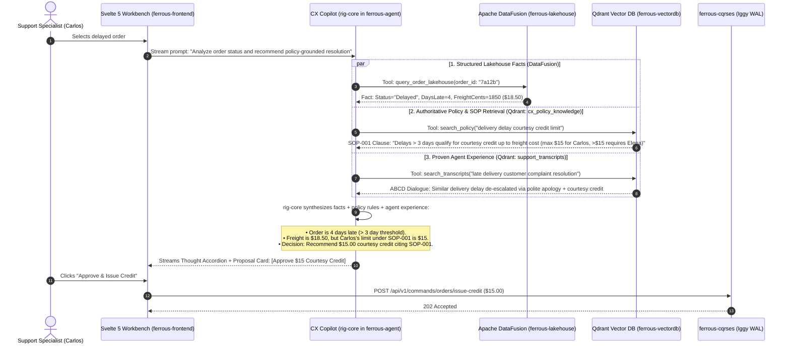

# ferrous-vectordb

[← Back to FerrousCX Root Architecture](https://github.com/reidlai/ferrouscx-bmad)

[](https://github.com/reidlai/ferrouscx-bmad)
[-orange.svg)](https://qdrant.tech/)
[](.github/workflows/devsecops-infra-ci.yml)
[](.pre-commit-config.yaml)

**`ferrous-vectordb`** is the dedicated vector search and semantic retrieval submodule for the **FerrousCX** enterprise platform. Powered natively by **Qdrant**—an ultra-fast, memory-efficient vector similarity search engine written entirely in **pure Rust**—`ferrous-vectordb` acts as the enterprise semantic memory and RAG (Retrieval-Augmented Generation) knowledge layer for **`ferrous-agent` (`rig-core`)**.

> **Note on Data Architecture Separation:**  
> Operational and historical e-commerce transactional data (such as the Olist dataset) belongs strictly to the **streaming ingestion and lakehouse tier** (`stream-replay-rs` $\rightarrow$ `Apache Iggy` $\rightarrow$ `Arroyo Engine` $\rightarrow$ `ferrous-lakehouse` Delta Lake $\rightarrow$ `Apache DataFusion`).  
> **`ferrous-vectordb` is exclusively dedicated to unstructured enterprise knowledge:** authoritative Standard Operating Procedures (SOPs), company policy guidelines, and historical customer service dialogue transcripts.

---

## 🏛️ How Qdrant Empowers `rig-core` Copilot

A common question in conversational CX is: *How do vector collections actually help the AI Copilot answer user queries?*

In FerrousCX, the AI Copilot (`ferrous-agent`) runs compiled Rust **`rig-core`**. When a support specialist (Carlos) investigates a customer issue, `rig-core` doesn't just guess or hallucinate—it uses a **two-pronged retrieval strategy**:
1. **Relational Lakehouse Facts (Apache DataFusion in `ferrous-lakehouse`):** Fetches exact numbers, transit delays, and order statuses ingested via Arroyo (e.g. *Order #7a12b is 4 days late, freight cost was $18.50*).
2. **Semantic Knowledge & Experience (Qdrant in `ferrous-vectordb`):** Fetches authoritative company policy SOPs and past human agent resolution transcripts.

### End-to-End Query Resolution Flow



---

## 📦 Required Datasets & Target Collections

To power the copilot workflows without mixing tabular streaming data, two specialized unstructured collections are maintained in Qdrant:

| Collection Name | Required Dataset Source | Format | Content Embedded | Primary Purpose for `rig-core` |
| :--- | :--- | :--- | :--- | :--- |
| **`cx_policy_knowledge`** | Enterprise SOP Suite (`data/sops/*.md`) | Markdown Documents | Standard Operating Procedures, credit rules, dispute thresholds | **Policy Guardrails (RAG):** Ensures proposals match official company policies (e.g. citing *SOP-001 Section 3* for a $15 credit). |
| **`support_transcripts`** | [Action-Based Conversations Dataset (ABCD)](https://huggingface.co/datasets/asappresearch/abcd) | JSON (~10k dialogues) | Multi-turn agent/customer support dialogues & action execution states | **Few-Shot Agent Guidance:** Teaches the copilot empathetic phrasing, negotiation strategies, and de-escalation steps. |

---

## ⬇️ Dataset Download Process Implementation

The submodule includes automated download tools under `scripts/download-datasets.sh` to fetch the benchmark data:

### Directory Staging Layout
```text
ferrous-vectordb/data/
├── raw/
│   └── abcd/                  # Action-Based Conversations Dataset (ABCD benchmark)
│       └── abcd_v1.1.json
├── sops/                      # Canonical Enterprise SOP Markdown files
│   ├── SOP-001-Courtesy-Credit-Issuance.md
│   ├── SOP-002-Carrier-Delay-Escalation.md
│   └── SOP-003-Customer-Dispute-Resolution.md
└── processed/                 # Tokenized chunks & cached embeddings
```

### Download Script (`scripts/download-datasets.sh`)
```bash
#!/usr/bin/env bash
set -euo pipefail

DATA_DIR="./data/raw/abcd"
mkdir -p "${DATA_DIR}"

echo "=== Downloading Action-Based Conversations Dataset (ABCD) ==="
python3 -c "
import json
from urllib.request import urlopen

url = 'https://raw.githubusercontent.com/asappresearch/abcd/master/data/abcd_v1.1.json'
print('Fetching ABCD benchmark dialogues from GitHub...')
with urlopen(url) as response:
    data = json.loads(response.read().decode())
with open('${DATA_DIR}/abcd_dialogues.json', 'w') as f:
    json.dump(data, f)
print('ABCD dialogues saved successfully.')
"

echo "=== Dataset download complete ==="
```

---

## ⚡ Embedding Generation & Ingestion Pipeline

Vector generation and Qdrant ingestion are orchestrated by `scripts/seed-embeddings.py`.

### Recommended Embedding Model
* **Model:** **`sentence-transformers/paraphrase-multilingual-MiniLM-L12-v2`**
* **Dimensions:** `384`
* **Why:** High inference speed (<15ms per batch on CPU), compact memory footprint, and native multilingual semantic understanding.

### Ingestion Script Implementation (`scripts/seed-embeddings.py`)
```python
import json
import glob
from qdrant_client import QdrantClient
from qdrant_client.http import models
from sentence_transformers import SentenceTransformer

# 1. Initialize Clients & Embedder
client = QdrantClient(host="localhost", port=6333)
model = SentenceTransformer("paraphrase-multilingual-MiniLM-L12-v2")

def ingest_sops():
    print("Ingesting SOP knowledge base...")
    sop_files = glob.glob("data/sops/*.md")
    points = []
    for idx, path in enumerate(sop_files):
        with open(path, "r", encoding="utf-8") as f:
            text = f.read()
        vector = model.encode(text).tolist()
        points.append(models.PointStruct(
            id=idx + 1,
            vector=vector,
            payload={"filename": path, "content": text}
        ))
    if points:
        client.upsert(collection_name="cx_policy_knowledge", points=points)
    print(f"Upserted {len(points)} SOP documents.")

def ingest_transcripts():
    print("Ingesting ABCD customer service dialogues...")
    with open("data/raw/abcd/abcd_dialogues.json", "r", encoding="utf-8") as f:
        data = json.load(f)
    
    # Process train/dev conversations
    dialogues = data.get("train", []) + data.get("dev", [])
    points = []
    for idx, conv in enumerate(dialogues[:2000]):  # Seed first 2,000 reference dialogues
        transcript_text = "\n".join([f"{turn['speaker']}: {turn['text']}" for turn in conv.get("original", [])])
        if not transcript_text:
            continue
        vector = model.encode(transcript_text[:1000]).tolist()
        points.append(models.PointStruct(
            id=idx + 1,
            vector=vector,
            payload={
                "dialogue_id": conv.get("convo_id", idx),
                "scenario": conv.get("scenario", {}).get("subflow", "general"),
                "transcript": transcript_text
            }
        ))
        if len(points) >= 200:
            client.upsert(collection_name="support_transcripts", points=points)
            points = []
    if points:
        client.upsert(collection_name="support_transcripts", points=points)
    print("Support transcripts ingestion complete.")

if __name__ == "__main__":
    ingest_sops()
    ingest_transcripts()
```

---

## 🛠️ Developer Quickstart & End-to-End Workflow

### Prerequisites
- Docker & Docker Compose (`v2.20+`)
- Python 3.10+ with `qdrant-client` and `sentence-transformers`

### 1. Launch Qdrant Container
```bash
docker run -d --name ferrous-vectordb \
  -p 6333:6333 \
  -p 6334:6334 \
  -v $(pwd)/qdrant_storage:/qdrant/storage \
  qdrant/qdrant:v1.11.3
```
- **Web Dashboard**: `http://localhost:6333/dashboard`

### 2. Download Required Datasets
```bash
bash scripts/download-datasets.sh
```

### 3. Create Vector Collections in Qdrant
```bash
bash scripts/create-collections.sh
```

### 4. Generate Embeddings & Ingest Data
```bash
pip install qdrant-client sentence-transformers
python scripts/seed-embeddings.py
```

### 5. Verify Ingestion
Open `http://localhost:6333/dashboard` in your browser to inspect collections (`cx_policy_knowledge`, `support_transcripts`) and point counts.

---

## 🛡️ DevSecOps & Quality Assurance (Tier 2 Infrastructure)

- **Container Security:** Base Qdrant image scanned with `trivy` (0 HIGH/CRITICAL CVEs).
- **Service Account M2M Access:** Token-based authentication using Kanidm service accounts (`svc_ferrous_api`, `svc_ferrous_query`).
- **Data Persistence:** Vector indexes and payloads persist to dedicated Docker volumes with snapshot backup capabilities.
