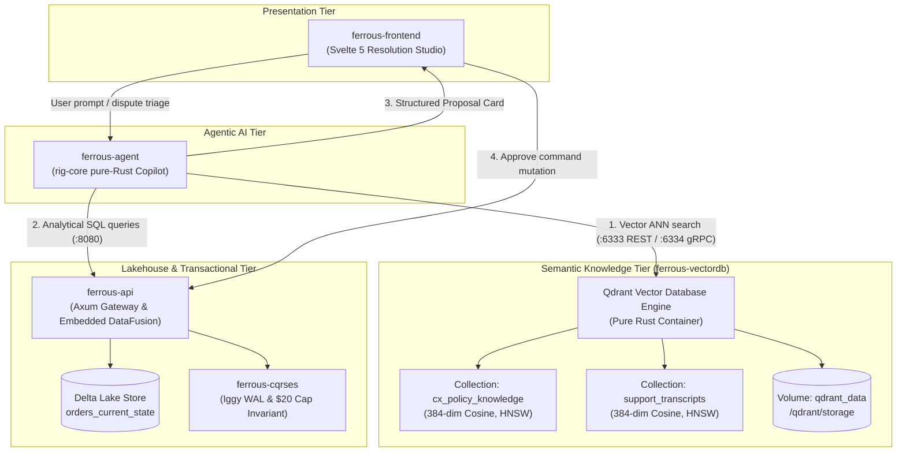
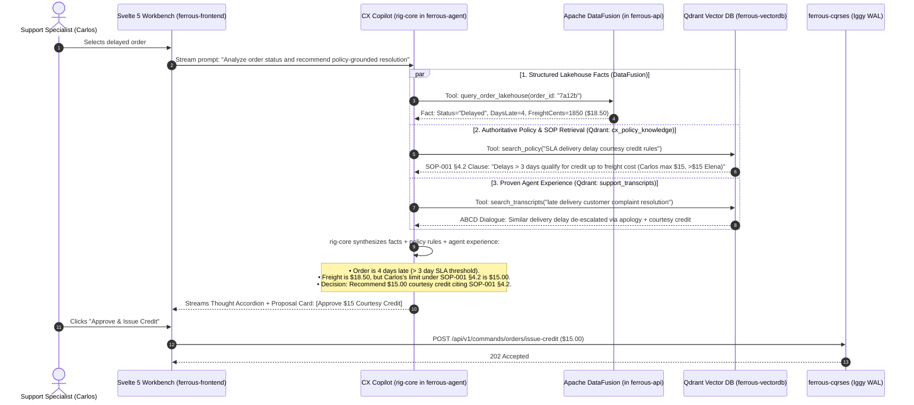

# ferrous-vectordb

[← Back to FerrousCX Root Architecture](https://github.com/reidlai/ferrous-cx)

[](https://github.com/reidlai/ferrous-cx)
[-orange.svg)](https://qdrant.tech/)
[](#tier-2-devsecops--engineering-standards-ad-13)
[](.pre-commit-config.yaml)

**`ferrous-vectordb`** is the dedicated vector search and semantic retrieval submodule for the **FerrousCX** enterprise platform. Powered natively by **Qdrant**—an ultra-fast, memory-efficient vector similarity search engine written entirely in **pure Rust**—`ferrous-vectordb` acts as the enterprise semantic memory and RAG (Retrieval-Augmented Generation) knowledge layer for **`ferrous-agent` (`rig-core`)**.

> [!IMPORTANT]
> **Strict Data Architecture Separation (AD-6, AD-13):**  
> Operational and historical e-commerce transactional data (such as the Olist dataset) belongs strictly to the **streaming ingestion and lakehouse tier** (`stream-replay-rs` $\rightarrow$ `Apache Iggy` $\rightarrow$ `Arroyo Engine` $\rightarrow$ Delta store in `ferrous-streaming` $\rightarrow$ `Apache DataFusion`).  
> **`ferrous-vectordb` is exclusively dedicated to unstructured enterprise knowledge:** authoritative Standard Operating Procedures (SOPs), company policy guidelines, and historical customer service dialogue transcripts.

---

## 🏛️ C4 Architecture Topology & Integration

The following C4 Container slice depicts how `ferrous-vectordb` integrates into the FerrousCX ecosystem to power the conversational copilot while maintaining strict domain boundaries:



---

## ⚡ Two-Pronged Hybrid Retrieval Pattern

When a Customer Support Specialist (Carlos) triages a delayed order, `ferrous-agent` executes a **two-pronged retrieval strategy** combining live tabular data with policy constraints:



---

## 📜 Goodwill Courtesy Credit Policy §4.2 Citations

Authoritative policy grounding is rooted in `data/sops/SOP-001-Courtesy-Credit-Issuance.md`:

* **SLA Trigger:** Shipping delays exceeding 3 business days past carrier promised delivery date qualify for courtesy credits up to the total freight charge.
* **Tier 1 Delegation (Carlos - Customer Support Specialist):** Autonomous approval authority up to **$15.00 USD** per order.
* **Tier 2 Delegation (Elena - Operations Manager):** Autonomous approval authority between **$15.01 and $20.00 USD** per order.
* **Hard Domain Invariant ($20.00 Ceiling):** Discretionary credits exceeding **$20.00 USD** are strictly prohibited and architecturally rejected at the write-ahead log (`ferrous-cqrses` AD-2, AD-17).
* **Semantic Search Verification (NFR-7, AD-6):** Dispatching query `"SLA delivery delay courtesy credit rules"` to collection `cx_policy_knowledge` returns SOP §4.2 with cosine similarity score **> 0.82** in **< 5 milliseconds**.

---

## 🗄️ Qdrant Collections & Schema Tables

Qdrant hosts two dedicated collections indexed with **Cosine** distance and tuned **HNSW** parameters:

| Configuration Parameter | Collection: `cx_policy_knowledge` | Collection: `support_transcripts` |
| :--- | :--- | :--- |
| **Vector Dimension** | `384` | `384` |
| **Distance Metric** | `Cosine` | `Cosine` |
| **Embedding Model** | `sentence-transformers/paraphrase-multilingual-MiniLM-L12-v2` | `sentence-transformers/paraphrase-multilingual-MiniLM-L12-v2` |
| **HNSW `m`** | `16` | `16` |
| **HNSW `ef_construct`** | `128` | `128` |
| **On-Disk Storage** | `true` (persistent payload and vector mmap) | `true` (persistent payload and vector mmap) |

### 1. `cx_policy_knowledge` Payload Schema

| Field Name | Type | Description | Example |
| :--- | :--- | :--- | :--- |
| `sop_id` | `string` | Unique SOP document identifier | `"SOP-001"` |
| `title` | `string` | Document title | `"Courtesy Credit Issuance & Delivery Delay Compensation"` |
| `section_id` | `string` | Granular section / clause anchor | `"SOP-001-s4.2"` |
| `section_title` | `string` | Specific clause title | `"§4.2 Goodwill Courtesy Credit Policy"` |
| `content` | `string` | Extracted policy text in Markdown | `"Courtesy credit rules for carrier delays..."` |
| `filename` | `string` | Source file path | `"data/sops/SOP-001-Courtesy-Credit-Issuance.md"` |
| `url` | `string` | Authoritative relative reference path | `"/docs/sops/SOP-001"` |
| `updated_at` | `string` | ISO 8601 ingestion timestamp | `"2026-11-08T18:00:00Z"` |

### 2. `support_transcripts` Payload Schema

| Field Name | Type | Description | Example |
| :--- | :--- | :--- | :--- |
| `dialogue_id` | `string` / `int` | ABCD benchmark dialogue identifier | `"abcd-1042"` |
| `scenario` | `string` | Domain interaction category | `"shipping_delay"` |
| `subflow` | `string` | Granular task subflow | `"courtesy_credit_negotiation"` |
| `transcript` | `string` | Formatted multi-turn agent/customer dialogue | `"Agent: Hello Carlos... Customer: My order is late..."` |
| `turns_count` | `int` | Total conversational turns in dialogue | `8` |

---

## 🌐 Port Mapping & Interface Contracts

| Port | Protocol | Binding | Purpose & Health Probes |
| :--- | :--- | :--- | :--- |
| **`6333`** | HTTP / REST | `0.0.0.0:6333` | REST API, Web UI Dashboard (`/dashboard`), and readiness health probe (`GET /readyz`) |
| **`6334`** | gRPC | `0.0.0.0:6334` | High-throughput binary vector search, batch upserts, and snapshot RPCs |

---

## 🐳 Dual Container Packaging & Orchestration (AD-6, AD-13, AD-23)

`ferrous-vectordb` delivers two standardized, hardened OCI container images:

| Target Image | Dockerfile | Base Image | Role & Invariants |
| :--- | :--- | :--- | :--- |
| **`ferrous-vectordb:latest`** | `Dockerfile` | `qdrant/qdrant:v1.12.0` | Pure-Rust vector database server with 384-dim Cosine metrics and HNSW index ($m=16$, $ef\_construct=128$), running as rootless user `UID 10001`, with `/readyz` healthcheck and persistent volumes at `/qdrant/storage`. |
| **`ferrous-vectordb-seeder:latest`** | `Dockerfile.seeder` | `python:3.12-alpine` | Minimal hardened CLI seeder running as rootless user `UID 10001`. Packages enterprise SOPs (`data/sops`), ABCD dialogues (`data/raw/abcd`), and `seed-embeddings.py`. Automatically bootstraps collections and executes idempotent upserts. |

### Docker Compose Multi-Service Topology

`docker-compose.yml` orchestrates both services with health probe dependencies:
* `vectordb`: exposes `6333`/`6334`, mounts persistent storage, and probes readiness via `GET /readyz`.
* `seeder`: waits for `vectordb` health (`condition: service_healthy`), bootstraps collections if missing, seeds 22 SOP and 8 ABCD transcript points, verifies sub-5ms semantic search, and exits cleanly.

```bash
# Launch Qdrant and execute knowledge seeder automatically
docker compose up -d

# Verify seeder dry-run point generation in container
docker run --rm ferrous-vectordb-seeder:latest --dry-run
```

---

## 🚀 Standalone Developer Quickstart (< 3 Minutes)

Developers can spin up and verify `ferrous-vectordb` locally in under 3 minutes without cloud dependencies:

### 1. Launch Qdrant & Knowledge Seeder (Turnkey Orchestration)
```bash
docker compose up -d
# Alternatively: docker run -d --name ferrous-vectordb -p 6333:6333 -p 6334:6334 ferrous-vectordb:latest
```

### 2. Verify Service Readiness Probe (< 5 seconds)
```bash
curl -f http://localhost:6333/readyz
# Expected output: all health checks return HTTP 200 OK
```

### 3. Initialize Collections (Optional / Manual Bootstrapping) (< 5 seconds)
```powershell
# PowerShell (Windows)
powershell -File scripts/create-collections.ps1

# POSIX (Linux / macOS)
bash scripts/create-collections.sh
```

### 4. Ingest Knowledge & Verify Semantic Search (< 15 seconds)
```bash
# Ingest enterprise SOPs & ABCD transcripts into Qdrant collections
python scripts/seed-embeddings.py
# (Supports offline dry-run validation via: python scripts/seed-embeddings.py --dry-run)
```

### 5. Run DevSecOps Local Audit & Build (< 30 seconds)
```powershell
# PowerShell (Windows) - Audits Dockerfile & Dockerfile.seeder, builds and Trivy-scans both images
powershell -File scripts/build-and-scan.ps1 -DryRun

# POSIX (Linux / macOS) - Audits Dockerfile & Dockerfile.seeder, builds and Trivy-scans both images
bash scripts/build-and-scan.sh --dry-run
```

### 6. Execute Automated Unit Tests (< 10 seconds)
```bash
python -m unittest discover -s tests -p "test_*.py"
# Verifies collection scaffolding, dataset ingestion, sub-5ms query latency, container packaging, and submodule standards
```

---

## 🛡️ Tier 2 DevSecOps & Engineering Standards (AD-13)

`ferrous-vectordb` satisfies the **Tier 2 Submodule Engineering Standards**:

1. **Pure Submodule Architecture (AD-13):**  
   Conserves cloud CI minutes by omitting `.github/workflows/` within the submodule. Comprehensive automated CI is consolidated at the root repository level (`ferrous-cx`), while local dual-shell scripts enforce quality gates.
2. **Shift-Left Pre-Commit Hygiene:**  
   Managed by `.pre-commit-config.yaml` with Gitleaks secret scanning, YAML format validation, trailing whitespace cleanup, and automated test hooks.
3. **Dual-Shell DevSecOps Automation:**  
   Cross-platform scripts (`scripts/build-and-scan.ps1` and `scripts/build-and-scan.sh`) run `hadolint` Dockerfile audits and `trivy` container image vulnerability scans (`--severity HIGH,CRITICAL --ignore-unfixed --exit-code 1`) across both `ferrous-vectordb:latest` and `ferrous-vectordb-seeder:latest`, enforcing **0 Dockerfile warnings** and **0 HIGH/CRITICAL CVEs**.
4. **Rootless Hardened Runtime:**  
   Both Docker containers execute as unprivileged user `UID 10001` (`USER 10001:10001`) with dropped Linux capabilities, with Qdrant maintaining persistent vector storage at `/qdrant/storage`.
